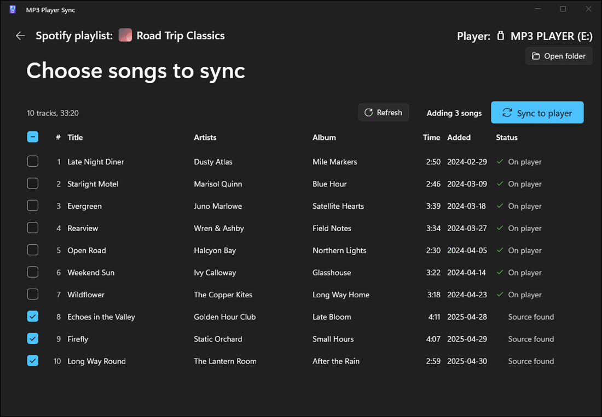
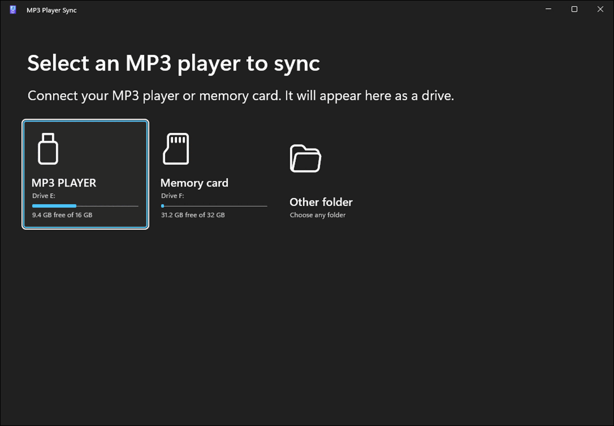
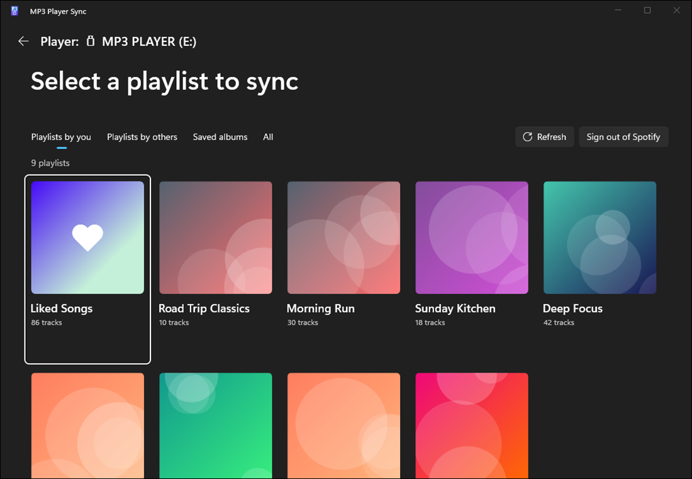
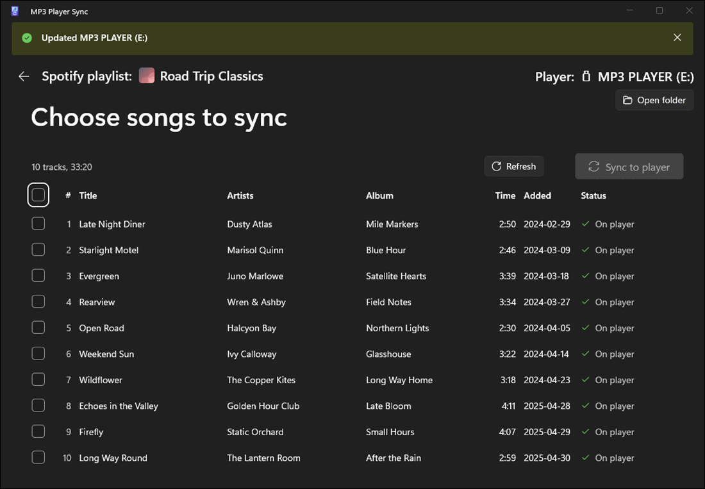

#  MP3 Player Sync [](https://github.com/jnm2/Mp3PlayerSync/actions/workflows/build.yml)

A Windows app for putting Spotify playlists and saved albums on an MP3 player or memory card. It finds each song on
YouTube Music, downloads it as AAC audio, tags it, and copies it to the player.



## Download

Requires Windows 11, a Spotify account, and an MP3 player or memory card that shows up as a drive.

1. Download [MP3-Player-Sync-x64.exe](https://github.com/jnm2/Mp3PlayerSync/releases/latest/download/MP3-Player-Sync-x64.exe).
   It runs on any Windows 11 PC, including Arm PCs.
   (Optional: on an Arm PC, [MP3-Player-Sync-arm64.exe](https://github.com/jnm2/Mp3PlayerSync/releases/latest/download/MP3-Player-Sync-arm64.exe)
   runs a little faster. It doesn't run on other PCs.)
2. Run it. No installation is needed. The exe isn't code-signed, so the first time Windows may show
   **Windows protected your PC**. Click **More info**, then **Run anyway**.

Release notes are on the [releases page](https://github.com/jnm2/Mp3PlayerSync/releases/latest).

## Usage

1. Connect the MP3 player or memory card and select it under **Select an MP3 player to sync**. The app remembers it
   for next time.

   

2. Sign in to Spotify (the first time only), then select a playlist or saved album under
   **Select a playlist to sync**.

   

3. Under **Choose songs to sync**, click **Sync to player**. The songs are copied into a folder named after the
   playlist, in playlist order.

   

When a match on YouTube Music is uncertain, the app asks before downloading anything: pick a result, paste a link to
the song, or skip it.

## Features

- A single .exe, with nothing to install.
- AAC audio (`.m4a`) tagged with title, artists, album, year, track number, genre and cover art.
- Syncing a playlist again updates its folder to match Spotify, without rewriting files that are already correct.

## File layout

| Item | Location on the player |
|------|------------------------|
| Playlist | `Playlist name\01. Artist - Title.m4a`, numbered in playlist order |
| Album | `Artist\Album (Year)\01. Title.m4a` |

Songs removed from a playlist on Spotify are left on the player, shown in italics, unless you mark them for removal.

## Building from source

Requires the [.NET 11 SDK](https://dotnet.microsoft.com/download).

```powershell
dotnet run --project src\Mp3PlayerSync
```

Unit tests ([TUnit](https://tunit.dev) and [Shouldly](https://docs.shouldly.org)): `dotnet test tests\Mp3PlayerSync.Tests`.
End-to-end tests run on a hidden desktop: `dotnet build Mp3PlayerSync.slnx`, then `pwsh tests\Invoke-EndToEnd.ps1`. They
are moving to C#, in `tests\Mp3PlayerSync.EndToEnd`: run those on a hidden desktop with
`dotnet run --project tests\Mp3PlayerSync.EndToEnd`, or run and debug them from Visual Studio's Test Explorer, which runs
the app on your own desktop, off-screen. The screenshots above are generated from a made-up library by
`pwsh tests\Update-ReadmeScreenshots.ps1`.

To release, push a tag such as `v0.1.1`, or `v0.2.0-beta.1` for a prerelease. The Build workflow then publishes the exes
to a GitHub release with exactly that version. Nothing needs to be bumped afterwards, because every other build bases its
version on the newest tag as a prerelease of the next patch version, such as `0.1.2-ci.<run>` on main and `0.1.2-dev`
locally. To make the next release a minor or major version, raise `VersionPrefix` in `Directory.Build.props`, for
example to `0.2.0`.

---

MP3 Player Sync isn't affiliated with or endorsed by Spotify or YouTube.